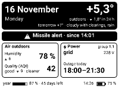
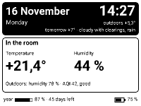
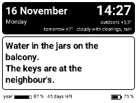
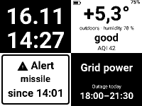
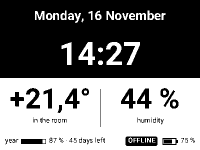
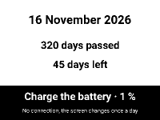
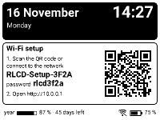
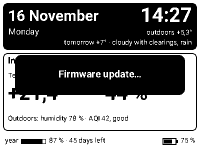

# rlcd-dashboard

Standalone firmware for the **Waveshare ESP32-S3-RLCD-4.2** board (reflective LCD, 400×300, 1 bit). The device collects its data and draws the screen itself; it does not need a server. The layout and the fonts follow the compact screen of `trmnl-server` (400×300).

Version **0.1.0**: a dashboard with Home Assistant data (outdoor weather and air, air raid alerts, power) and the meteo.gov.ua forecast, air raid alerts from ubilling.net.ua without Home Assistant, seven screens, four modes of operation (from an always-on connection to fully offline) and two low-battery modes, a DS3231 or PCF85063 clock, Wi-Fi with a backup network and a fallback access point, a settings page on the device with a first-start wizard, MQTT for Home Assistant, signed updates over Wi-Fi, Ukrainian and English.

The texts below use the English names of the screens and the settings; the firmware starts in Ukrainian, and the first-start wizard or the settings page switches the language.

## Screens

| Screen | Look | What it shows | Needs |
|---|---|---|---|
| **Dashboard** | [](docs/screens/en/dashboard.png) | As the compact screen of `trmnl-server`: the date, the outdoor temperature with its 24-hour change, tomorrow's forecast; the alert strip; "Air outdoors" (humidity, AQI, 24-hour changes); "Power" (state, UPS voltage, next outage or power back); at the bottom the year progress, the data time and the battery | Home Assistant |
| **Room** | [](docs/screens/en/room.png) | The date and the clock, the room temperature and humidity (SHTC3), a short line about the weather outdoors (from Home Assistant, when there is one) | — |
| **Note** | [](docs/screens/en/note.png) | The date and the clock at the top, below them your text from the settings page (up to 250 characters, new lines with Enter). The font size is automatic: a shorter text gets larger letters | a text |
| **4 quadrants** | [](docs/screens/en/quad.png) | The screen in 4 equal parts, the top left and the bottom right ones black. In large type: the date and the time (`13.11` and `9:24`, 64 px); the outdoor temperature (56 px) and AQI; the alert (with a frame and a warning sign when there is one); the power state and the next change. Small icons at the top left: "ECO" (only in the first minute after the switch to eco mode), a crossed Wi-Fi icon without a connection, "Charge the battery"; in the top corners of the white quadrant, in black: the battery at the left (with a bolt on USB power), the charge percent at the right | Home Assistant |
| **From server** | [](docs/screens/en/server.png) | The same 4 quadrants, but `trmnl-server` draws three of them (an image every 5 min), and the device draws the top left one (the date, the time and the icons) itself each minute (see "The server screen") | trmnl-server |
| **Clock** | [](docs/screens/en/clock.png) | The offline mode: the weekday and the date on black at the top, the time in large digits under them; the room temperature and humidity (SHTC3) below; the battery and "OFFLINE" at the bottom. Wi-Fi, MQTT and the Home Assistant data are off (see "Clock (offline mode)") | — |
| **Days of the year** | [](docs/screens/en/days.png) | Only below 2 % battery (extreme power saving), as the DaysInYear screen of `trmnl-server`: the date with the year, the days of the year that passed and that are left; on black at the bottom "Charge the battery · N %" and "No connection, the screen changes once a day". It is not in the KEY cycle, on the page or in Home Assistant, and it is not kept | — |
| Wi-Fi setup | [](docs/screens/en/setup.png) | Comes on with the access point: the network name, the password, a QR code | — |
| Message | [](docs/screens/en/message.png) | A black box in the middle of the screen: "Firmware update…", "Resetting the settings…" | — |

The thumbnails are half size; a click opens the full screen (twice 400 × 300). The firmware code draws them with sample data: `tools/screens/render.py` builds `components/ui`, the fonts and the texts for a computer (gcc on Linux or in WSL: `python3 tools/screens/render.py`) and writes `docs/screens/uk/` and `docs/screens/en/`. Make them again after a change of the screens.

The KEY button changes the screens in a circle; the choice is kept, also after a restart. The circle has only the available screens: "Note" when it has a text, "Dashboard" and "4 quadrants" when there is Home Assistant, "From server" when there is trmnl-server (see "First setup"). On the settings page, in the "Screen" section, the buttons change the screen at once, without a restart, and "Show the text" saves a new text and shows it at once; Home Assistant can select the screen too. The crossed Wi-Fi icon comes only when the device must have a connection and has none; in eco mode and on "From server" Wi-Fi is off on purpose, so there is no icon. The device information (IP, time source, MQTT, battery, Home Assistant state, alerts, time zone, eco mode) is on the settings page, in the "Device" block.

## Modes of operation

The device works in one of four modes; two more come on by themselves when the battery is low. The screen and the "Eco mode" switch (on the page or in Home Assistant) set the mode.

| Mode | How to turn it on | Wi-Fi and MQTT | Data and screen | Alert sound | Settings page |
|---|---|---|---|---|---|
| **Always connected** | any screen except "From server" and "Clock", eco mode off | on all the time | Home Assistant once a minute, the alerts and the forecast on their own schedule; the screen each minute; Home Assistant commands at once | yes | always |
| **Eco** | the "Eco mode" switch | only during a session, every 5–240 min (default 30) | the data and the Home Assistant commands during a session; the time on the screen each minute | no (nobody at home) | during a session, 2 min after BOOT and while somebody uses it |
| **Semi-offline** | the "From server" screen | only during a session, every 1–30 min (default 5) | the `trmnl-server` image (without it the Home Assistant data), the Home Assistant commands, the room data and the battery to Home Assistant during a session; the date and the time each minute | no | during a session, 2 min after BOOT and while somebody uses it |
| **Offline** | the "Clock" screen | off | only the time and the room (SHTC3), each minute | no | no; KEY goes back |
| **Low battery** (below 10 %) | by itself | off | "Clock"; with USB power back to the previous screen | no | no |
| **Extreme power saving** (below 2 %) | by itself | off | "Days of the year" once a day, at midnight; the battery every 10 min | no | no |

- **Session** (eco and semi-offline modes): the device turns Wi-Fi on, then MQTT after the connection, gets the data and the commands, sends its sensors and turns everything off again. A short BOOT press starts a session now and keeps Wi-Fi on for 2 min for the page. A button press during a session stops the waits: KEY changes the screen at once, Wi-Fi goes on with the connection in the background.
- **Sleep.** Between the sessions and the updates of each minute the processor sleeps (light sleep); the display keeps its image itself. In the always-connected mode on battery the processor sleeps between the Wi-Fi beacons (automatic light sleep). With USB power from a computer the device does not sleep, so that USB works (see "Hardware").
- **Mode changes**: KEY (next screen), the page, Home Assistant (the "Screen" select, the "Eco mode" switch). The page asks before it switches to an offline screen: only the buttons switch back.
- **Battery.** Below 10 % the device switches to "Clock" itself and keeps the previous screen (also after a restart); with USB power it goes back to it. Below 2 %: "Days of the year"; with USB power back to its screen. More in "Clock (offline mode)".

## Build and flash

ESP-IDF **v6.1** is necessary.

1. Open a terminal with ESP-IDF: on Windows "ESP-IDF PowerShell" (a shortcut of the installer), on Linux and macOS `. $IDF_PATH/export.sh`.
2. In the project folder copy `sdkconfig.secrets.example` to `sdkconfig.secrets` and write the Wi-Fi name and password there (optional: MQTT and the page password). `sdkconfig.secrets` does not go to git.
3. Make the firmware signing key once (see "Firmware signature"):
   ```powershell
   idf.py secure-generate-signing-key --version 2 --scheme rsa3072 rlcd-signing-key.pem
   ```
   `rlcd-signing-key.pem` in the project folder does not go to git. Keep a copy in a safe place.
4. Build and flash the board on a USB cable (`idf.py` finds the port itself):
   ```powershell
   idf.py build
   idf.py flash monitor
   ```
   `Ctrl+]` closes the log.

`idf.py build` also makes the archive for the update over Wi-Fi: `build/rlcd-dashboard-<version>.tar` (see "Firmware update over Wi-Fi"). The version is `PROJECT_VER` in `CMakeLists.txt`. Next to it the page and Home Assistant show the git commit of the build: `0.1.0 (75cd8c4)`, with uncommitted changes `0.1.0 (75cd8c4-dirty)`. Each build reads the commit (`tools/git-version.cmake`).

ESP-IDF reads `sdkconfig.defaults` and `sdkconfig.secrets` only when it makes a new `sdkconfig`. After a change of `sdkconfig.secrets`, delete `sdkconfig` in the project folder and build again.

If the board does not flash: turn it off with PWR, hold BOOT and turn it on with PWR: the board goes to the download mode.

### Build on GitHub

[.github/workflows/build.yml](.github/workflows/build.yml) builds the firmware (container `espressif/idf:v6.1`) after each push to `main` or `master` and for each pull request; the files are in the `rlcd-dashboard` artifact of the run (the archive for the update over Wi-Fi and the images for USB). A tag `v*` (for example `v0.2.0`) also makes a release with the archive `rlcd-dashboard-<version>.tar`.

A tag also updates the GitHub Pages site (the web flasher and the archive, see below). The archive `https://<owner>.github.io/<repository>/rlcd-dashboard.tar` is always the last release (with the versioned archive next to it). Only the build on GitHub writes this address into the firmware as the default update address (`CONFIG_RLCD_OTA_URL`; a local build takes its own from `sdkconfig.secrets`), so "Check for an update" on the page sees a new release without settings. Turn Pages on once: Settings → Pages → Source: GitHub Actions, and let tags deploy the site: Settings → Environments → `github-pages` → Deployment branches and tags → Add deployment branch or tag rule → type Tag, pattern `v*` (without this rule the deployment of a tag fails: "Tag "v0.1.0" is not allowed to deploy to github-pages due to environment protection rules").

Signature: put the content of `rlcd-signing-key.pem` into the repository secret `RLCD_SIGNING_KEY` (Settings → Secrets and variables → Actions). Without the secret (for example in a fork) the build signs the firmware with a temporary key, and devices with your key do not accept it; the run summary tells it.

The tag must be `PROJECT_VER` of `CMakeLists.txt` (tag `v0.2.0` for version `0.2.0`): the release page shows the tag, the archive and the firmware show `PROJECT_VER`.

### Flash from the browser

The GitHub Pages site (`https://<owner>.github.io/<repository>/`) is an [ESP Web Tools](https://esphome.github.io/esp-web-tools/) flasher: Chrome or Edge on a computer flash the board through Web Serial, without ESP-IDF. [tools/web-flasher/make_site.py](tools/web-flasher/make_site.py) makes the site from each tag: the page, `manifest.json` with the images and the offsets from `build/flasher_args.json` of the build (bootloader, partition table, `ota_data_initial.bin`, firmware), and the archive for the update over Wi-Fi.

- "Flash the board" → select the port of the board. A sleeping board does not answer on USB: hold BOOT, press RESET (or plug the cable again), release BOOT.
- The first install erases the device (the page asks), then use the access point `RLCD-Setup-…` and the first-start wizard.
- The firmware of the site is signed with the key of the repository (`RLCD_SIGNING_KEY`) and looks for updates on the same site, so the device then updates over Wi-Fi ("Check for an update").

## Settings

The values of `sdkconfig.secrets` are only the start values. Then the **settings page** of the device changes everything and keeps it in its memory (NVS): the main and the backup Wi-Fi network, DNS, MQTT, the page password. After "Save" the device restarts.

How to open the page:
- **Through the access point of the device.** It comes on by itself when no network connects, or with the BOOT button (hold 3 s). The screen shows the network name `RLCD-xxxx`, the password, the address `http://10.0.0.1` and a QR code: scan it with a phone, and the phone connects itself. The page opens by itself (captive portal) or at `http://10.0.0.1`. Through the access point the page password is never necessary.
- **From the home network** at `http://rlcd.local` (mDNS, see below) or at the IP address of the device (on the page and in Home Assistant), for example `http://192.168.1.50`. Without a page password the page opens without one. With a password the page asks for the user `admin` and that password.

**mDNS.** The device announces itself as `<name>.local`, where the name is the first part of the field "Device name in the network" (default `rlcd.local`, so `rlcd.local`; with `rlcd.lan` also `rlcd.local`). Computers and phones find it without a local DNS: Windows 10 and later, macOS, iOS, Linux with Avahi, Android 12 and later. The device announces the settings page as an `_http._tcp` service (with a certificate also `_https._tcp`), with the firmware version in the TXT record. mDNS works on the home network and in the access point; in eco mode and on "From server" only during a session, because Wi-Fi is off between the sessions. The "Device" block shows the name: "Network name: rlcd.local (mDNS)".

Connection order: the main network (~20 s) → the backup network (~20 s) → again → the access point. While the access point is on and nobody is connected to it, the device tries the networks again every 5 min. When the device is connected and nobody uses the access point for 10 min, it goes off.

**Buttons**

| Button | Action |
|---|---|
| KEY | Next screen (in eco mode without Wi-Fi) |
| BOOT, short | Update the screen (in eco mode also keep Wi-Fi on for 2 min) |
| BOOT, 3–10 s | Turn on the access point for the setup |
| BOOT, 10 s and longer | Erase the settings (the values of `sdkconfig.secrets` apply) and restart |

**Build settings** (`idf.py menuconfig` → "RLCD dashboard")

| Setting | Default | Description |
|---|---|---|
| `RLCD_WIFI_SSID`, `RLCD_WIFI_PASSWORD` | empty | Main Wi-Fi network (start value) |
| `RLCD_WIFI2_SSID`, `RLCD_WIFI2_PASSWORD` | empty | Backup network |
| `RLCD_DNS1`, `RLCD_DNS2` | empty | DNS servers instead of the ones of the router |
| `RLCD_MQTT_URI`, `RLCD_MQTT_USER`, `RLCD_MQTT_PASSWORD` | empty | MQTT broker, for example `mqtt://homeassistant.local:1883` |
| `RLCD_MQTT_PREFIX` | `homeassistant` | MQTT discovery prefix |
| `RLCD_WEB_PASSWORD` | empty | Settings page password on the home network (empty: no password) |
| `RLCD_AP_IP` | `10.0.0.1` | Address of the device in its access point (network /24) |
| `RLCD_TZ` | `EET-2EEST,M3.5.0/3,M10.5.0/4` | Time zone (Kyiv) until Home Assistant gives one (see "Daylight saving time") |
| `RLCD_LANGUAGE` | `uk` | Language of the screen, the page and the Home Assistant entities: `uk` or `en` (see "Languages and texts"); then on the page |
| `RLCD_METEO_STATION` | empty | meteo.gov.ua forecast station (`33345` is Kyiv); then a list of cities on the page and in Home Assistant |
| `RLCD_HOST` | `rlcd.local` | Device name: the first part is for DHCP and mDNS (`rlcd.local`), the full name is the name of the HTTPS certificate; then on the page |
| `RLCD_SERVER_URL` | empty | Image of the "From server" screen (`http://server:15000/quad.bmp`); then on the page |
| `RLCD_OTA_URL` | empty (on GitHub: the Pages address) | Firmware archive for "Check for an update"; the page keeps the last address |
| `RLCD_ALERT_REGION` | empty | ubilling.net.ua alert region, as in the API answer (`м. Київ`, `Київська область`); then a list on the page and in Home Assistant |
| `RLCD_NTP_SERVER` | `pool.ntp.org` | Time server |
| `RLCD_ROOM_TEMP_OFFSET_X10` | `0` | Correction of the SHTC3 temperature, tenths of °C (the board is a little warm) |
| `RLCD_VBUS_SENSE_GPIO` | `-1` | Pin with a divider from VBUS for an exact USB detection (see "Power") |

## First setup

After the first start (and after a reset with BOOT 10 s) the settings page first shows a wizard: the language, Wi-Fi, whether there is Home Assistant (address and token) and trmnl-server (image address), the forecast city and the alert region. "Save and restart" keeps the answers; the "All settings" link opens the full page without the wizard.

- Without Home Assistant the "Dashboard" and "4 quadrants" screens are not available: the weather, the air and the power come from it. They are not in the KEY cycle, on the page or in the Home Assistant screen list; a kept screen that is not available changes to "Room".
- Without trmnl-server the "From server" screen is not available.
- Change the answers later with the checkboxes "I have Home Assistant" and "I have trmnl-server" in their sections of the page.
- A device that had settings before the wizard (a Wi-Fi network is set) does not show the wizard: the answers come from its settings (an HA address means Home Assistant, an image address means trmnl-server).

## Data from Home Assistant

The device reads Home Assistant through the REST API with a long-lived access token (Profile → Security → Long-lived access tokens). Set the address, the token and the entities in the first-start wizard and on the settings page, or in `sdkconfig.secrets` (examples in `sdkconfig.secrets.example`).

- Once a minute one `POST /api/template` request: the template returns the state, the change time and the unit of all entities together.
- The values of 24 hours ago for the 24-hour change come from `/api/history/period`, one entity a minute; each value is read again every 15 min.
- Tomorrow's forecast comes from the meteo.gov.ua informer for the selected city, once an hour. Select the city from the list of the regional centres on the page ("Weather forecast" section, applies at once) or in Home Assistant (the "Forecast: city" select). Donetsk and Luhansk are not in the list: meteo.gov.ua does not update their forecasts. With English the forecast text is English too (the English informer).
- The current weather also comes from the meteo.gov.ua informer (its current weather block: temperature, humidity, observation time) when Home Assistant gives no outdoor temperature or humidity: no entity, or it does not answer. Then the device reads the informer every 30 min; observations older than 3 h are not shown; there is no 24-hour change. On the page: "Weather now: meteo.gov.ua, +5°, 78 %, observation at 14:50".
- Alerts come from the Home Assistant entities (drone and missile); without them from ubilling.net.ua (see "Alerts without Home Assistant").
- Without Home Assistant the screens show what the other sources give (current weather and forecast of meteo.gov.ua, alerts of ubilling.net.ua): each source checks the age of its own data.
- The logic is the same as in `trmnl-server`: the main entity, or a backup one when it is not available or older than 30 min; the UPS state "OL/OB" or its voltage; the Svitlo.live outage schedule; the alert text with its start time.
- Data older than 5 min is not shown ("n/a", "No alert data").

**Power: three states.** The screen shows one of three: "Grid power", "Generator power", "No power". DTEK is the grid operator of Kyiv.

- The UPS works from its battery ("OB" or a low input voltage): no power.
- There is grid power: grid.
- The UPS has input power and there is no grid power: generator.
- The UPS does not answer (for example, its battery is empty) and there is no grid power: no power.

There is no "n/a" for the power.

**Grid power** comes from the first source that knows it ("Grid power" section of the settings page):

1. A Home Assistant entity with the state `on/off`.
2. A healthchecks.io check (as in `trmnl-server`): a read-only API key (Project Settings → API Access) and the check (slug, UUID or unique_key). `up` means grid power, `grace` (the ping is late) and `down` mean no grid power. Every 5 min: an HTTPS request costs more battery.
3. A ping of a device on the home network without backup power (IP or name), only when the first two tell nothing. It answers: grid power; no answer (or no such address): no grid power. 3 pings, one answer is enough; once a minute, in eco mode during the update.

When no source tells anything, there is no grid power.

The "Device" block of the settings page shows what the device read.

**Daylight saving time.** Home Assistant gives the UTC offset and the date of the change to summer or winter time: a separate `POST /api/template` request returns the offset now, the time of the next change (up to 400 days ahead) and the new offset. So Home Assistant must have the correct time zone (Settings → System → General; for Kyiv `Europe/Kyiv`).

- The device keeps the answer in its memory (NVS) and changes the offset itself at the time of the change, also without Wi-Fi (on "Clock" too).
- It does not ask each minute, only when necessary: after the first start (no answer yet), every quarter (90 days), a week before the change (to see changed dates) and after the change (to learn the next one). Without an answer it asks again in an hour.
- In eco mode and on "From server" the request goes during a session; the session waits up to 5 s for the answer.
- Until Home Assistant answers, the firmware rules apply (`CONFIG_RLCD_TZ`).
- The "Device" block shows it: "Time zone: UTC+2:00 (from Home Assistant), change to UTC+3:00 DD.MM.YYYY at HH:MM" or "firmware rules…".

## Alerts without Home Assistant (ubilling.net.ua)

When the alert entity fields (drone and missile) are empty (no Home Assistant, or no alert integration in it), the device takes the alerts from the [Ubilling air raid alert API](https://wiki.ubilling.net.ua/doku.php?id=aerialalertsapi): `GET https://ubilling.net.ua/aerialalerts/?source=klimenko&raw`, without a key.

- Select the region on the page ("Alerts without Home Assistant" section, applies at once), in the first-start wizard or in Home Assistant (the "Alerts: region" select). The list has Kyiv city, the oblasts, Crimea and Sevastopol.
- The alert levels are the same as for the Home Assistant entities: red is "Missile alert", yellow is "Drone alert"; an alert without a level counts as red. The start time comes from the `enabled_at` field.
- One request a minute (in eco mode during the update); the API allows up to 2 requests a second. Data older than 5 min is not shown ("No alert data").
- Only oblast-level alerts: the source has the districts too, but the device does not read them.
- The "Device" block shows the state: "Alerts: ubilling.net.ua, «Kyiv city», data at HH:MM".

## Home Assistant (MQTT)

With a broker in the settings, the device makes the "RLCD Dashboard" device in Home Assistant (MQTT discovery) with these entities:

| Entity | Description |
|---|---|
| Room temperature, Room humidity | SHTC3 |
| Battery | % |
| Battery voltage, Wi-Fi signal | diagnostics |
| USB power | binary sensor |
| Sync session | the time of the last MQTT connection. In eco mode and on "From server" each session is a new connection, so the Home Assistant activity shows each session; in the normal mode the value changes only after a new connection |
| Eco mode | switch (see "Eco mode") |
| Update in eco mode | number, min (5–240, default 30) |
| Alert sound | switch (see "Sound") |
| Volume | number, % (0–100) |
| Screen | select: Dashboard, Room, Note, 4 quadrants, From server, Clock; only the available screens (see "First setup"), names in the language of the device. In the normal mode the screen changes at once, in eco mode and on "From server" at the next session; "Clock" does not hear commands (no connection), KEY switches it back. A change with KEY or on the page goes to Home Assistant too |
| Update of the «From server» screen | number, min (1–30, default 5): how often the "From server" screen turns the connection on |
| Forecast: city | select: "No forecast" and the regional centres; applies at once (in eco mode at the session) |
| Alerts: region | select: "Not set", Kyiv city, the oblasts; for the alerts of ubilling.net.ua when the settings have no alert entities |

Topics: `rlcd/rlcd_xxxxxx/state` (JSON, once a minute), `rlcd/rlcd_xxxxxx/status` (`online`/`offline`), `rlcd/rlcd_xxxxxx/eco[/set]`, `rlcd/rlcd_xxxxxx/eco_min[/set]`. The device page in Home Assistant has a link to the settings page.

## Sound

An 8 Ω / 2 W speaker goes to the SPK connector; the sound goes through the ES8311 codec and the NS4150B amplifier. The codec and the amplifier are on only while a sound plays: after the start the firmware puts ES8311 into power-down at once (until the first sound), and ES7210 (the microphones; the firmware does not use them) into power-down, so that they take no current, also in sleep.

- A separate sound for three events: the start of a missile alert, the start of a drone alert, the all clear (all alerts ended). When both start together, the missile sound plays.
- Built-in sounds: "Siren" (~4 s, the tone goes up and down), "Warning tone" (two fast alternating tones, ~3 s), "Short beeps" (5 beeps), "All-clear melody" (three calm falling tones), "No sound". Defaults: missile siren, drone warning tone, all-clear melody.
- **Own sounds:** on the settings page ("Alert sound" → "Own sounds") upload a WAV file for each event and select "Own file" for the event. The file stays on the device (the `sounds` flash partition, 2 MB per event) and stays after a firmware update.
  - Format: WAV without compression (PCM), 8 or 16 bit, mono or stereo, 8000–48000 Hz. The device keeps mono 16 bit: up to ~63 s at 16000 Hz, up to ~23 s at 44100 Hz; it plays up to 60 s.
  - Convert MP3 or OGG first, for example: `ffmpeg -i siren.mp3 -ac 1 -ar 22050 -sample_fmt s16 siren.wav`.
- All of this, the sound switch and the volume change on the page at once, without a restart. Home Assistant has the switch and the volume too ("Alert sound" switch, "Volume" number). The "Play" buttons first save the volume and the sounds of the form, then play the sound of the event.
- The first state after the start gives no sound (so that nothing sounds after a restart during an alert); old data (more than 5 min) gives none either.
- Eco mode has no sound: nobody is at home.

## Eco mode

Turn it on on the settings page ("Eco mode" section, applies at once) or from Home Assistant with the "Eco mode" switch (for example, with the "nobody at home" automation that turns other devices off). MQTT is not necessary for it.

- The device wakes up every N min (5–240): it turns Wi-Fi on, gets the Home Assistant data, updates the screen, publishes its sensors, gets the commands, then turns Wi-Fi and MQTT off and sleeps (light sleep). The RLCD keeps its image itself: the display pins stay driven also during sleep.
- Home Assistant keeps the command on the broker (retained), so a sleeping device sees it at the next wake-up, at most N min later. A change on the page is written to this command too, so Home Assistant does not set the old value back.
- MQTT disconnects cleanly, so the entities stay available in Home Assistant while the device sleeps.
- MQTT starts after the Wi-Fi connection: a first try without a network puts the next one 10 s later, and the session would end before MQTT connects.
- Without Wi-Fi (for example, a router without power) the access point does not come on by itself: the device sleeps until the next time, to save the battery.
- KEY shows the next screen with the last data at once, without Wi-Fi. A short BOOT press updates the data now and keeps Wi-Fi on for 2 min to open the settings page. While somebody uses the page, the device does not sleep. BOOT 3 s: the access point; while it is on, the device does not sleep.
- During the check of a new firmware after an update (90 s) the device does not sleep.
- With USB to a computer the device does not sleep deeply, so that the log works, but Wi-Fi is still off between the updates.

The 3.3 V converter of the board takes the most energy (~60 mW); Wi-Fi and the processor take almost nothing between the updates.

## The server screen

The "From server" screen is in the KEY cycle after "4 quadrants" and a button on the settings page. It is the semi-offline mode: a connection only every 5 min (the interval of 1–30 min is on the page in the "Eco mode" section and in Home Assistant, "Update of the «From server» screen").

- `trmnl-server` gives the image: `GET http://server:15000/quad.bmp` (the "trmnl-server image" field on the page), BMP 400 × 300, 1 bit. It has the weather and AQI, the alert and the power, as on the "4 quadrants" screen; the top left quadrant is empty.
- Between the sessions Wi-Fi and MQTT are off, the device sleeps (light sleep) and draws the date and the time in the top left quadrant each minute. "ECO" shows only in the first minute after the switch to this mode (as in eco mode); there is no Wi-Fi icon, because Wi-Fi is off on purpose.
- Every 5 min (or the set interval) the device turns Wi-Fi and MQTT on: it gets the image (and sees whether it changed), gets the Home Assistant commands (the screen select among them), sends the room temperature, humidity and the battery, and turns the connection off again. A short BOOT press: a session now, Wi-Fi for 2 min to open the page, and 30 s without sleep for USB; while somebody uses the page, Wi-Fi stays on (the `/ping` check of an open page does not keep it on).
- The device does not ask Home Assistant, healthchecks.io, meteo.gov.ua or the ping itself: the server gives the data. This screen has no alert sound.
- Without the server the device works with what it has. When `trmnl-server` does not answer (the device tries three times with a 2 s pause), the device reads Home Assistant in the same session and, when the image is older than 15 min, draws the quadrants itself ("HA data" at the top right). Without an image and without fresh data (no Wi-Fi) it shows the last image with "data at HH:MM" and tries again in 5 min. The clock and the room data always go on.
- The state of the last request is on the settings page ("trmnl-server image: new / no change / error at HH:MM"); after a good request it also shows the last error with its time.
- Check the image in a browser: `http://server:15000/quad.bmp`; samples without Home Assistant: `/dev/preview?layout=quad&sample=missile` of trmnl-server in the Development mode.

## Clock (offline mode)

The "Clock" screen is in the KEY cycle after "From server" and a button on the settings page (the page asks first: Wi-Fi goes off).

- While it is on the screen, Wi-Fi and MQTT are off, there are no Home Assistant requests and no alert sound. The time comes from the clock chip (PCF85063 or DS3231): each minute the firmware compares the processor clock with it, because in sleep the processor clock is not accurate. Without Wi-Fi NTP does not correct the time.
- The device sleeps (light sleep) and wakes up once a minute to update the time, the temperature, the humidity and the battery. This saves more than eco mode: Wi-Fi does not come on at all. When eco mode is on, the clock has priority.
- KEY: the next screen. It shows the last data at once, then the device turns Wi-Fi and MQTT on, gets the Home Assistant data and draws the screen again. The buttons do not wait for this session: a press stops the waits for Wi-Fi, the image and the data (Wi-Fi goes on connecting in the background), and KEY changes the screen at once. The same during a session on "From server" and in eco mode. A short BOOT press updates the clock now and keeps the device awake for 30 s (so that a computer on USB sees the device); BOOT 3 s: Wi-Fi and the access point (while it is on, the clock waits); BOOT 10 s: reset of the settings.
- The screen choice is kept: after a restart the device stays offline.
- Below 2 %: extreme power saving. Wi-Fi and MQTT are off, the screen shows only the date, the days of the year that passed and that are left (as the DaysInYear screen of trmnl-server) and "Charge the battery · N %" at the bottom. The screen changes once a day, at midnight; every 10 min the device only reads the battery. This screen is not in the KEY cycle, in the settings or in Home Assistant, and it is not kept: after a restart the device looks at the charge again. The buttons do not change the screen; BOOT: 30 s without sleep (for USB), BOOT 10 s: reset. With USB power the device goes back to its screen.
- When the battery falls below 10 %, the device switches to "Clock" itself and keeps the previous screen (also after a restart). As soon as there is USB power (a computer or a charger), it goes back to that screen. A manual screen choice in this time (KEY, the page, Home Assistant) cancels the return; the next switch to "Clock" below 10 % comes only after a charge above 15 %. The "Device" block of the page shows it.
- The "Clock" and "From server" buttons on the page first warn about the offline mode and that only the buttons on the device switch it back. An open page asks the device every 10 s (`GET /ping`); after two requests without an answer the top of the page shows "The device seems to be offline. Change the mode with the buttons on the device" (in eco mode a note about BOOT, on the other screens "The device does not answer").
- When the page was opened over HTTPS before (with a certificate of your own authority), the browser keeps a small page for the time without a connection (service worker, `/sw.js` and `/offline.html`). While the device sleeps, after 10 s the browser shows the same text about the offline mode (for the last known state) and the time of the last answer of the device instead of "This site can't be reached". The page checks `/ping` every 10 s and opens itself as soon as the device answers. Over HTTP browsers do not run service workers.
- During the check of a new firmware after an update (90 s) the clock waits, and with a computer on USB the device does not sleep (the log works).
- The USB of the chip does not work in sleep, so a computer does not see a sleeping device ("USB device not recognized"). After you connect a computer, press BOOT shortly: the device does not sleep for 30 s, the computer sees it, and then it does not sleep while USB is connected. When the battery charges, the device also stops sleeping by itself as soon as it sees the charge (in 2–3 min). The same on "From server" and in eco mode.

## Hardware

The pins come from the schematic of the board (`ESP32-S3-RLCD-4.2-schematic.pdf`); the full list is in [components/board/include/board.h](components/board/include/board.h).

| Device | Connection |
|---|---|
| ST7305 display | SPI: SCK 11, MOSI 12, CS 40, DC 5, RST 41 |
| I2C | SDA 13, SCL 14 |
| SHTC3 | I2C `0x70` |
| PCF85063 (clock on the board) | I2C `0x51` |
| Buttons | KEY: GPIO18, BOOT: GPIO0 |
| Battery | GPIO4, divider 200K/100K (×3) |
| Speaker 8 Ω / 2 W | SPK connector, ES8311 codec + NS4150B amplifier (GPIO46) |

**DS3231 module** (optional) keeps the time on a CR2032 cell while the board is off. Connect it with male–female jumper wires to the 2×8 header:

| DS3231 | Board | Wire color |
|---|---|---|
| GND | GND | violet |
| VCC | **3V3** (not VBUS!) | blue |
| SDA | SDA (GPIO13) | green |
| SCL | SCL (GPIO14) | yellow |

The firmware looks for DS3231 (`0x68`) at the start. When it is there, the time comes from it, else from PCF85063. After each Wi-Fi connection the firmware asks NTP for the time and writes it to the clock, correct to some milliseconds. Between the synchronizations the processor clock follows the chip: in sleep it runs from the internal RC oscillator, which is not accurate. The status page shows the time of the last synchronization. The cell is necessary only while the board has no power at all. On a ZS-042 module, remove the charging diode (a CR2032 cell must not charge) and the power LED (1–3 mA).

**Power.** With USB the board runs from USB, and the battery only charges and stays in reserve (an "ideal diode" on Q3/Q4/Q6). The 3.3 V converter (TPS63020) works in forced PWM, so the board takes ~60 mW also in sleep: an 18650 cell lasts some days.

**Sleep between Wi-Fi beacons.** On battery and in the normal mode the processor sleeps (automatic light sleep) and lowers its frequency when nothing runs; Wi-Fi stays connected and wakes up for the beacons of the router. The page and MQTT answer a little slower (tenths of a second). On USB power there is no sleep, and with a computer on USB the log works. The page shows the state: "Sleep between Wi-Fi beacons: yes / no".

**Battery charge.** The percent comes from the discharge curve of a Li-ion cell (18650): 4.19 V is 100 %, 3.75 V is 50 %, 3.60 V is 20 % ("Charge the battery"), 3.30 V is 0 %. Between the updates the device takes the median of three readings (separately with Wi-Fi on and off: the Wi-Fi load lowers the voltage), and on battery the percent goes up only by 5 % or more, so voltage noise does not move it. During a sound the battery is not read: the speaker takes much current. On charge the voltage is higher than the charge shows: the charge current goes through the resistance of the cell and the wires, and at the start of the charge the voltage jumps by 0.2–0.3 V. So on USB the percent is an estimate: the voltage before the charge plus its rise since then; from 4.18 V the charger keeps 4.2 V (the cell is at about 80 % then), and the estimate goes up from at least 80 % by 1 % in 3 min to 100 %. On charge the estimate does not go down. An unplug in the middle of the charge gives the real percent, without a jump from 100 %. When the device did not see the start of the charge (it started on USB), there is no percent, only the bolt and "USB", and Home Assistant gets an empty value.

**USB detection.** The board has no "USB present" signal: VBUS goes only to the charger and the header. So the firmware guesses:
- a computer on USB is certain (data comes from USB);
- a charger or a power bank shows only in the battery voltage: a rise of 80 mV over the lowest voltage on battery means a charge current (on battery the voltage only falls). The lowest and the highest voltage are separate for Wi-Fi on and off: else the higher voltage in sleep ("Clock", "From server") would look like a charge, and the older, lower readings with Wi-Fi (every 5 min on "From server") like the end of the charge. A fall of 30 mV under the highest charge voltage in the same state means that the charge ended or USB was disconnected. 4.2 V on charge is not 100 % yet: at this voltage the charger only starts the final phase (the cell is at about 80 %), and its LED shows the full charge. The device sees a charge in 2–3 min. A full battery at rest is not USB: it shows its percent.

For an exact signal two resistors are necessary: VBUS (header) → 100K → GPIO2 → 100K → GND, and `CONFIG_RLCD_VBUS_SENSE_GPIO=2`. GPIO2 then has 2.5 V from the 5 V of USB.

## Structure

```text
main/                   loop: sensors → state → screen and MQTT, once a minute or on a button
components/board        pins, I2C bus, buttons (short / 3 s / 10 s), battery, USB
components/st7305       display driver (init sequence from the Waveshare examples, Apache-2.0)
components/sensors      SHTC3, clock DS3231 / PCF85063
components/gfx          1-bit graphics: shapes, UTF-8 text, generated fonts
components/settings     settings in NVS, start values from the build
components/net          Wi-Fi: main and backup network, access point 10.0.0.1, DNS, SNTP, mDNS (espressif/mdns)
components/dns_server   DNS for the captive portal (from the ESP-IDF example, Unlicense / CC0)
components/web          settings page: screen, HA, Wi-Fi, DNS, MQTT, device state, first-start wizard
components/fwupdate     update from an archive: tar, manifest.json, SHA-256, OTA, download from a URL
components/tlscert      HTTPS: key and request (CSR) on the device, certificate of your own authority in NVS
components/hass         MQTT and discovery for Home Assistant (espressif/mqtt)
components/hadata       HA data (template, 24-hour history), meteo.gov.ua forecast and weather, ubilling.net.ua alerts (espressif/cjson)
components/srvimg       image of the "From server" screen from trmnl-server: 1-bit BMP, every 5 min
components/audio        sound: ES8311 through espressif/esp_codec_dev, the siren and the tones are made in code
components/util         time: ISO 8601, UTC without a time zone
components/ui           screens: dashboard, room, Wi-Fi setup with a QR code (espressif/qrcode), ...
components/texts        texts in the selected language: tr(), trn(), tra() from the tables of tools/lang.py
lang/                   language files: uk.json, en.json
tools/lang.py           generator of the text tables (CMake runs it), checks the keys and the conversions
tools/web-flasher       release site on GitHub Pages: ESP Web Tools flasher and update archive
tools/export-public.py  snapshot of the sources for a public repository, with a check for local network names
tools/screens           pictures of the screens for the README: the screen code built with gcc, sample data
docs/screens            thumbnails and full pictures of the screens (uk, en)
tools/fontgen           font generator (.NET)
tools/fw-archive.cmake  firmware archive with manifest.json (idf.py build runs it)
```

## Firmware update over Wi-Fi (OTA)

The firmware for the update is the archive `build/rlcd-dashboard-<version>.tar`; `idf.py build` makes it. The archive has two files, in this order:

- `manifest.json`: project, version, git commit, build time, build fingerprint (SHA-256 of the ELF file), chip, name and size of the firmware file, SHA-256:
  ```json
  {
    "project": "rlcd-dashboard",
    "version": "0.1.0",
    "git": "754311d",
    "built": "2026-11-14 19:34",
    "elf_sha256": "…",
    "chip": "esp32s3",
    "file": "rlcd-dashboard.bin",
    "size": 1372656,
    "sha256": "…"
  }
  ```
- `rlcd-dashboard.bin`: the firmware itself.

The "Firmware update" section of the settings page has these ways:

- **From a file:** select the archive and press "Update from the file".
- **From an address:** type the URL of the archive (`http://` or `https://`, with redirects) and press "Download and update". The device downloads the archive itself, and the page shows the progress. The settings keep the address for the next time. For `https://` the certificate of the server must come from a well-known certificate authority (the ESP-IDF bundle).
- **Check for an update:** the device reads only `manifest.json` from the same address (the first entry of the archive, without the firmware) and compares it with its own firmware. The same build (the same ELF fingerprint) gives "no update"; else the page tells the version on the server (newer, older or another build of the same version, with the commit and the build time) and asks before the update. The default address is `CONFIG_RLCD_OTA_URL`: only the build on GitHub sets the GitHub Pages address of its repository (see "Build on GitHub"); a local build takes it from `sdkconfig.secrets`, without it the field is empty. The device keeps the last address. To let the check see new builds, put them on the server under the same name (or change the address when the version in the file name changes).

Checks:

- The device reads the archive as a stream. First `manifest.json`: the project and the chip must be the ones of the device, the size must fit the partition.
- Then the start of the firmware: an application for the ESP32-S3 of this project, with the same version as the manifest. A `.bin` file without an archive, a bootloader, a full flash image or another firmware is refused, and nothing is erased.
- During the write to the other partition (`ota_0` / `ota_1`) the device calculates SHA-256. The new partition becomes the boot partition only when SHA-256 is the one of the manifest and `esp_ota_end` accepts the image. During the write the screen shows "Firmware update…".
- SHA-256 protects from a damaged or cut file. The signature protects from a forged one: `esp_ota_end` checks the RSA-3072 signature with the public key of the running firmware (see "Firmware signature").
- After the restart the new version must update the screen twice in 90 s. Then it confirms itself. If not (it hangs or restarts), the bootloader goes back to the previous version.
- The update does not change the settings (NVS).

The rollback needs the bootloader setting `CONFIG_BOOTLOADER_APP_ROLLBACK_ENABLE` (it is in `sdkconfig.defaults`). Only USB updates the bootloader, so the first time after OTA came: delete `sdkconfig` in the project folder, build and flash through USB. The "Device" block of the settings page shows whether the rollback is on. Do not turn on anti-rollback: it burns eFuses.

### Firmware signature

Over Wi-Fi the device accepts only firmware signed with your key (`CONFIG_SECURE_SIGNED_APPS_NO_SECURE_BOOT` and `CONFIG_SECURE_SIGNED_ON_UPDATE_NO_SECURE_BOOT` in `sdkconfig.defaults`, the RSA-3072 scheme of Secure Boot V2).

- `idf.py build` signs `build/rlcd-dashboard.bin` with the key `rlcd-signing-key.pem` (`CONFIG_SECURE_BOOT_SIGNING_KEY`). Without the key the build stops and tells how to make it.
- The device checks a new firmware with the public key in the signature of the running one. So write the first signed firmware through USB, then update over Wi-Fi.
- This is not the hardware Secure Boot: no eFuses are burned, and USB can flash anything. The signature protects the update over the network.
- When the key is lost, the update over Wi-Fi is not possible any more: make a new key and flash through USB.
- Never put the key into git (`*.pem` is in `.gitignore`).

## HTTPS for the settings page

The page can work over HTTPS with a certificate of your own certificate authority (CA). A public authority does not issue certificates for home names such as `rlcd.lan`.

- **Device name**: the "Device name in the network" field on the page (default `rlcd.local`, in the build `CONFIG_RLCD_HOST`). The first part (`rlcd`) goes to the router as the DHCP name and to mDNS (`rlcd.local`); routers with a local DNS (for example, OpenWrt with the `lan` domain) also answer for `rlcd.lan`. The full name is the name of the certificate: with `rlcd.lan` the page redirects to `https://rlcd.lan`, so the certificate must be for it (a certificate can have both names: `DNS:rlcd.lan,DNS:rlcd.local`).
- **Certificate authority**: your own, for example with OpenSSL. Make the authority and install its `ca.crt` on phones and computers once. The device certificate is for the device name (`subjectAltName=DNS:rlcd.local`, optionally also `IP:<address>`), with `extendedKeyUsage=serverAuth`; browsers accept up to 825 days.
- **Way 1, the key on the device** (the key never leaves the device): on the page "Make a key and a request (CSR)" → the browser saves `rlcd.local.csr`. Sign the request with your authority, for example:
  ```bash
  openssl x509 -req -in rlcd.local.csr -CA ca.crt -CAkey ca.key -CAcreateserial -days 825 -sha256 \
    -extfile <(printf 'subjectAltName=DNS:rlcd.local\nextendedKeyUsage=serverAuth') -out rlcd.local.crt
  ```
  Then "Install the certificate" on the page with the file `rlcd.local.crt`.
- **Way 2, the key from the authority** (for a device without a request): make a key and a certificate for the device name with your authority → "Install the key and the certificate" on the page. Then delete the key on the computer.
- The device checks that the certificate fits the key and is not expired, keeps them in NVS and restarts. Then on the home network `http://…` redirects to `https://…` with the same name or IP. Through the access point the page stays on HTTP (phones open the sign-in page only over HTTP).
- The page shows the validity of the certificate. To renew it, repeat way 1 or 2. "Delete the certificate" sets the page back to HTTP only.
- When the HTTPS server does not start (for example, a damaged certificate), the page stays on HTTP, so that the device stays reachable.

## Languages and texts

All texts of the screen, the settings page, the messages and the Home Assistant entities are in the language files [lang/uk.json](lang/uk.json) and [lang/en.json](lang/en.json). Select the language in the first-start wizard or on the page ("Settings page" section; the device restarts after the save); the default is `CONFIG_RLCD_LANGUAGE`.

- A key with a text: `"date.day_month": "%d %s"`. A text can have `printf` conversions (`%s`, `%d`, `%.1f`).
- A plural is an object with the forms of the plural rule of the language: Ukrainian `{"one": "%d день", "few": "%d дні", "many": "%d днів"}`, English `{"one": "%d day", "other": "%d days"}`.
- A list is an array (months, weekdays, screen names, cities, regions); the code sets the order.
- The `js.*` keys go to the page scripts as one object `L`.
- `_language`: the code, the name of the language and the plural rule.

[tools/lang.py](tools/lang.py) makes C tables from them at the build (`texts_ids.h`, `texts_data.c` in the build folder), and the code gets the texts with `tr(T_...)`, `trn(T_..., n)` (plural) and `tra(T_..., i)` (list). The build stops when a language misses a key, has another kind, another number of list items or `%` conversions that are not the Ukrainian ones in type and order (a wrong `%s` in a translation would crash the firmware). `_Static_assert` checks the lengths of the lists that the code must know (12 months, 6 screens, cities, regions).

A new language: copy `lang/en.json` to `lang/<code>.json`, change `_language` and the texts; for a language with another plural rule add the rule to `tools/lang.py` (`PLURAL_FORMS`) and a function `texts_plural_<rule>` to [components/texts/texts.c](components/texts/texts.c). The fonts have Latin and Cyrillic; other scripts need new fonts (see "Fonts").

## Fonts

The fonts are Roboto (Apache License 2.0) as 1-bit bitmaps. The generator draws the glyphs with the same libraries (SixLabors) and sizes as `trmnl-server` and makes them black and white with a 50 % threshold, as the server. So the coordinates of `DashboardRenderer.cs` work without changes.

Character set: Latin, Cyrillic (with ґ, є, і, ї), `° · « » – — … № ’ ʼ −`. The large 56 and 64 px fonts (`roboto_b56d`, `roboto_b64d`) have only the digits and `+ − , . : ° % —`, to save space. The sizes are in [tools/fontgen/fonts.json](tools/fontgen/fonts.json). After a change make them again:

```powershell
dotnet run --project tools/fontgen -- tools/fontgen/fonts.json
```

## License

[MIT](LICENSE). The Roboto fonts and the bitmaps made from them: Apache License 2.0; the other parts from other projects are in [NOTICE](NOTICE).
