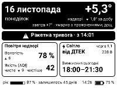
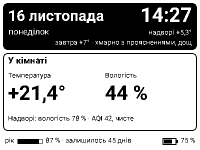
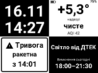
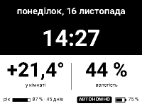
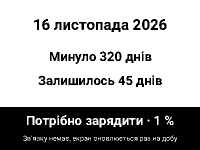
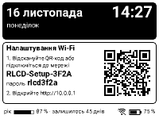
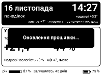

# rlcd-dashboard

Автономна прошивка для плати **Waveshare ESP32-S3-RLCD-4.2** (відбивний РК-екран 400×300, 1 біт). Пристрій сам збирає дані й сам малює екран, сервер йому не потрібен. Макет і шрифти повторюють компактний екран `trmnl-server` (400×300).

Стан: **0.1.0**. Дашборд з даними Home Assistant (погода й повітря надворі, тривоги, світло) і прогнозом meteo.gov.ua, тривоги з ubilling.net.ua без HA, сім екранів, чотири режими роботи (від постійного підключення до повної автономності) і два режими при розряді батареї, годинник DS3231 або PCF85063, Wi-Fi з запасною мережею й аварійною точкою доступу, сторінка налаштувань на самому пристрої з майстром першого запуску, MQTT для Home Assistant, оновлення через Wi-Fi, українська й англійська мови.

## Екрани

| Екран | Вигляд | Що показує | Потрібно |
|---|---|---|---|
| **Дашборд** | [](docs/screens/uk/dashboard.png) | Як компактний екран `trmnl-server`: дата, температура надворі зі зміною за добу, прогноз на завтра; смуга тривоги; «Повітря надворі» (вологість, AQI, зміни за добу); «Світло» (стан, напруга ДБЖ, наступне вимкнення чи увімкнення); унизу прогрес року, час даних і батарея | Home Assistant |
| **Кімната** | [](docs/screens/uk/room.png) | Дата й годинник, температура й вологість у кімнаті (SHTC3), коротко погода надворі (з HA, якщо він є) | — |
| **Текст** | [](docs/screens/uk/note.png) | Дата й годинник угорі, нижче — ваш текст зі сторінки налаштувань (до 250 символів, рядки — з Enter). Шрифт добирається сам: що коротший текст, то більші літери | непорожній текст |
| **4 квадрати** | [](docs/screens/uk/quad.png) | Екран поділено на 4 рівні частини, ліва верхня й права нижня — чорні. Великим шрифтом: дата й час (`13.11` і `9:24`, 64 px); температура надворі (56 px) і AQI; тривога (з рамкою й знаком, коли вона є); світло — стан і наступна зміна. У лівому верхньому куті маленькі значки: «ЕКО» (лише першу хвилину після переходу в економний режим), перекреслений Wi-Fi без зв'язку, «Потрібно зарядити»; у верхніх кутах білого квадрата, чорним: батарея ліворуч (з блискавкою на USB), відсоток заряду праворуч; температура на 5 px нижче, щоб вони не налазили на неї | Home Assistant |
| **З сервера** | [](docs/screens/uk/server.png) | Ті самі 4 квадрати, але три з них малює `trmnl-server` (картинка раз на 5 хв), а верхній лівий — дату, час і значки — пристрій щохвилини сам (див. «Екран з сервера») | trmnl-server |
| **Годинник** | [](docs/screens/uk/clock.png) | Автономний режим: угорі на чорному — день тижня й дата, під ними великим шрифтом час; нижче температура й вологість у кімнаті (SHTC3); унизу заряд батареї й позначка «АВТОНОМНО». Wi-Fi, MQTT і дані з HA вимкнені (див. «Годинник (автономний режим)») | — |
| **Дні року** | [](docs/screens/uk/days.png) | Лише при заряді нижче 2 % (екстремальне енергозбереження), як екран DaysInYear у `trmnl-server`: дата з роком, скільки днів року минуло й скільки залишилось; унизу на чорному «Потрібно зарядити · N %» і «Звʼязку немає, екран оновлюється раз на добу». Його немає в колі KEY, на сторінці й у HA, він не зберігається | — |
| Налаштування Wi-Fi | [](docs/screens/uk/setup.png) | Вмикається сам разом із точкою доступу: назва мережі, пароль, QR-код | — |
| Повідомлення | [](docs/screens/uk/message.png) | Чорна плашка посередині екрана: «Оновлення прошивки…», «Скидання налаштувань…» | — |

Мініатюри — у половину розміру, клік відкриває екран повністю (у 2 рази більше за 400 × 300). Їх малює код прошивки з тестовими даними: `tools/screens/render.py` збирає `components/ui`, шрифти й тексти для комп'ютера (gcc на Linux або в WSL: `python3 tools/screens/render.py`) і пише `docs/screens/uk/` і `docs/screens/en/`. Після зміни екранів перегенеруйте їх.

Кнопка KEY перемикає екрани по колу; вибір зберігається і переживає перезапуск. У колі лише доступні екрани: «Текст» — коли він не порожній, «Дашборд» і «4 квадрати» — коли є Home Assistant, «З сервера» — коли є trmnl-server (див. «Перше налаштування»). На сторінці налаштувань, у розділі «Екран», кнопки перемикають екран одразу, без перезапуску, а «Показати текст» зберігає новий текст і одразу його показує; екран можна вибрати й у HA. Перекреслений значок Wi-Fi з'являється лише тоді, коли пристрій мав би бути на зв'язку, але не підключений; в економному режимі й на «З сервера» Wi-Fi вимкнено навмисно, тож значка немає. Інформація про пристрій (IP, джерело часу, MQTT, батарея, стан HA, тривоги, часовий пояс, економний режим) — на сторінці налаштувань, у блоці «Пристрій».

## Режими роботи

Пристрій працює в одному з чотирьох режимів; ще два вмикаються самі, коли сідає батарея. Режим задають екран і перемикач «Економний режим» (на сторінці або в HA).

| Режим | Як увімкнути | Wi-Fi і MQTT | Дані й екран | Звук тривог | Сторінка налаштувань |
|---|---|---|---|---|---|
| **Постійне підключення** | будь-який екран, крім «З сервера» й «Годинника», економний режим вимкнено | увімкнені весь час | HA раз на хвилину, тривоги й прогноз — за своїм розкладом; екран щохвилини; команди HA — одразу | є | завжди |
| **Економний** | перемикач «Економний режим» | лише під час сеансу раз на 5–240 хв (за замовчуванням 30) | дані й команди HA — під час сеансу; час на екрані — щохвилини | немає (вдома нікого) | під час сеансу, 2 хв після BOOT і поки нею користуються |
| **Напівавтономний** | екран «З сервера» | лише під час сеансу раз на 1–30 хв (за замовчуванням 5) | картинка `trmnl-server` (без неї — дані HA), команди HA, кімнатні дані й заряд у HA — під час сеансу; дата й час — щохвилини | немає | під час сеансу, 2 хв після BOOT і поки нею користуються |
| **Автономний** | екран «Годинник» | вимкнені | лише час і кімната (SHTC3), щохвилини | немає | ні; назад — кнопкою KEY |
| **Мало заряду** (нижче 10 %) | сам | вимкнені | «Годинник»; з живленням USB — повернення на попередній екран | немає | ні |
| **Екстремальне енергозбереження** (нижче 2 %) | сам | вимкнені | «Дні року» раз на добу, опівночі; батарея — раз на 10 хв | немає | ні |

- **Сеанс** (економний і напівавтономний режими): пристрій вмикає Wi-Fi, після підключення — MQTT, бере дані й команди, надсилає свої датчики і знову все вимикає. BOOT коротко — сеанс зараз і Wi-Fi на 2 хв для сторінки. Натискання кнопки під час сеансу перериває очікування: KEY одразу перемикає екран, Wi-Fi підключається далі у фоні.
- **Сон.** Між сеансами й щохвилинними оновленнями процесор спить (light sleep), екран тримає зображення сам. У режимі постійного підключення на батареї процесор засинає між сигналами Wi-Fi (automatic light sleep). З живленням USB від комп'ютера пристрій не засинає, щоб працював USB (див. «Залізо»).
- **Перехід між режимами** — кнопкою KEY (наступний екран), на сторінці, у HA (вибір «Екран», перемикач «Економний режим»). В автономний режим зі сторінки — з попередженням, що назад лише кнопками.
- **Батарея.** Нижче 10 % пристрій сам переходить на «Годинник» і пам'ятає попередній екран (і після перезапуску); з живленням USB — повертається на нього. Нижче 2 % — «Дні року»; з USB — знову на свій екран. Детальніше — у розділі «Годинник (автономний режим)».

## Збирання й прошивання

Потрібен ESP-IDF **v6.1**.

1. Відкрийте термінал з ESP-IDF: на Windows — «ESP-IDF PowerShell» (ярлик інсталятора), на Linux і macOS — `. $IDF_PATH/export.sh`.
2. У теці проекту скопіюйте `sdkconfig.secrets.example` у `sdkconfig.secrets` і впишіть назву та пароль Wi-Fi (необов'язково — MQTT і пароль сторінки). Файл `sdkconfig.secrets` не потрапляє в git.
3. Один раз створіть ключ підпису прошивки (див. «Підпис прошивки»):
   ```powershell
   idf.py secure-generate-signing-key --version 2 --scheme rsa3072 rlcd-signing-key.pem
   ```
   Файл `rlcd-signing-key.pem` у теці проекту не потрапляє в git. Збережіть його копію в надійному місці.
4. Зберіть і прошийте плату, підключену USB-кабелем (порт `idf.py` знаходить сам):
   ```powershell
   idf.py build
   idf.py flash monitor
   ```
   Вийти з логу — `Ctrl+]`.

`idf.py build` також робить архів для оновлення через Wi-Fi: `build/rlcd-dashboard-<версія>.tar` (див. «Оновлення прошивки через Wi-Fi»). Версія — `PROJECT_VER` у `CMakeLists.txt`. Поруч із нею сторінка й Home Assistant показують хеш git-коміту, з якого зібрано прошивку: `0.1.0 (75cd8c4)`, а з незакоміченими змінами — `0.1.0 (75cd8c4-dirty)`. Хеш читається під час кожної збірки (`tools/git-version.cmake`).

ESP-IDF читає `sdkconfig.defaults` і `sdkconfig.secrets` лише тоді, коли створює новий `sdkconfig`. Якщо змінили `sdkconfig.secrets` після першої збірки, видаліть `sdkconfig` у теці проекту і зберіть знову.

Якщо плата не прошивається: вимкніть її кнопкою PWR, затисніть BOOT і ввімкніть PWR — плата перейде в режим завантаження.

### Збирання на GitHub

[.github/workflows/build.yml](.github/workflows/build.yml) збирає прошивку (контейнер `espressif/idf:v6.1`) після кожного push у `master` і для кожного pull request; файли — в артефакті `rlcd-dashboard` запуску (архів для оновлення через Wi-Fi і образи для прошивання через USB). Тег `v*` (наприклад `v0.2.0`) ще й створює реліз з архівом `rlcd-dashboard-<версія>.tar`.

Тег також оновлює сайт на GitHub Pages (прошивальник з браузера й архів, див. нижче). Архів — `https://<власник>.github.io/<репозиторій>/rlcd-dashboard.tar` — завжди останній реліз (і поруч архів з версією). Цю адресу лише збірка на GitHub записує в прошивку як адресу оновлення за замовчуванням (`CONFIG_RLCD_OTA_URL`; локальна збірка бере свою з `sdkconfig.secrets`), тож «Перевірити оновлення» на сторінці бачить новий реліз без налаштувань. Один раз увімкніть Pages: Settings → Pages → Source: GitHub Actions.

Підпис: вміст `rlcd-signing-key.pem` покладіть у секрет репозиторію `RLCD_SIGNING_KEY` (Settings → Secrets and variables → Actions). Без секрету (наприклад, у форку) збірка підписує прошивку тимчасовим ключем, і пристрої з вашим ключем її не приймуть — про це пише підсумок запуску.

Номер тегу має збігатися з `PROJECT_VER` у `CMakeLists.txt` (тег `v0.2.0` — версія `0.2.0`): сторінка релізу показує тег, а архів і прошивка — `PROJECT_VER`.

### Прошивання з браузера

Сайт на GitHub Pages (`https://<власник>.github.io/<репозиторій>/`) — прошивальник [ESP Web Tools](https://esphome.github.io/esp-web-tools/): Chrome або Edge на комп'ютері прошиває плату через Web Serial, без ESP-IDF. Сайт робить [tools/web-flasher/make_site.py](tools/web-flasher/make_site.py) з кожного тегу: сторінка, `manifest.json` з образами й зміщеннями з `build/flasher_args.json` збірки (завантажувач, таблиця розділів, `ota_data_initial.bin`, прошивка), архів для оновлення через Wi-Fi.

- Кнопка «Прошити плату» → виберіть порт плати. Плата, що спить, на USB не відповідає: затисніть BOOT, натисніть RESET (або перепідключіть кабель), відпустіть BOOT.
- Перше прошивання — зі стиранням (сторінка питає), далі точка доступу `RLCD-Setup-…` і майстер першого налаштування.
- Прошивка з сайту підписана ключем репозиторію (`RLCD_SIGNING_KEY`) і шукає оновлення там само, тож далі пристрій оновлюється через Wi-Fi («Перевірити оновлення»).

## Налаштування

Значення з `sdkconfig.secrets` — лише початкові. Далі все змінюється на **сторінці налаштувань** самого пристрою й зберігається в його пам'яті (NVS): основна й запасна мережа Wi-Fi, DNS, MQTT, пароль сторінки. Після «Зберегти» пристрій перезапускається.

Як відкрити сторінку:
- **Через точку доступу пристрою.** Вона вмикається сама, якщо жодна мережа не підключилася, або вручну кнопкою BOOT (затиснути на 3 с). На екрані з'являються назва мережі `RLCD-xxxx`, пароль, адреса `http://10.0.0.1` і QR-код: відскануйте його телефоном, і телефон підключиться сам. Сторінка відкривається сама (captive portal) або за адресою `http://10.0.0.1`. Через точку доступу пароль сторінки не потрібен.
- **З домашньої мережі** за IP-адресою пристрою (видно в заголовку екрана), наприклад `http://192.168.1.50`. Поки пароль сторінки не задано, вона відкривається без пароля. Якщо задати пароль, сторінка питатиме користувача `admin` і цей пароль.

Порядок підключення: основна мережа (~20 с) → запасна (~20 с) → ще раз → точка доступу. Поки точка доступу ввімкнена й до неї ніхто не підключений, пристрій раз на 5 хв знову пробує мережі. Коли пристрій підключений, а точкою доступу ніхто не користується 10 хв, вона вимикається.

**Кнопки**

| Кнопка | Дія |
|---|---|
| KEY | Наступний екран (в економному режимі — без увімкнення Wi-Fi) |
| BOOT, коротко | Оновити екран (в економному режимі — і лишити Wi-Fi на 2 хв) |
| BOOT, 3–10 с | Увімкнути точку доступу для налаштування |
| BOOT, 10 с і довше | Стерти налаштування (діють значення з `sdkconfig.secrets`) і перезапустити |

**Параметри збірки** (`idf.py menuconfig` → «RLCD dashboard»)

| Параметр | За замовчуванням | Опис |
|---|---|---|
| `RLCD_WIFI_SSID`, `RLCD_WIFI_PASSWORD` | порожньо | Основна мережа Wi-Fi (початкове значення) |
| `RLCD_WIFI2_SSID`, `RLCD_WIFI2_PASSWORD` | порожньо | Запасна мережа |
| `RLCD_DNS1`, `RLCD_DNS2` | порожньо | DNS-сервери замість тих, що дає роутер |
| `RLCD_MQTT_URI`, `RLCD_MQTT_USER`, `RLCD_MQTT_PASSWORD` | порожньо | Брокер MQTT, наприклад `mqtt://homeassistant.local:1883` |
| `RLCD_MQTT_PREFIX` | `homeassistant` | Префікс MQTT discovery |
| `RLCD_WEB_PASSWORD` | порожньо | Пароль сторінки налаштувань у домашній мережі (порожньо — без пароля) |
| `RLCD_AP_IP` | `10.0.0.1` | Адреса пристрою в його точці доступу (мережа /24) |
| `RLCD_TZ` | `EET-2EEST,M3.5.0/3,M10.5.0/4` | Часовий пояс (Київ), поки немає даних від Home Assistant (див. «Літній час») |
| `RLCD_LANGUAGE` | `uk` | Мова екрана, сторінки й сутностей HA: `uk` або `en` (див. «Мови й тексти»); далі — на сторінці |
| `RLCD_METEO_STATION` | порожньо | Станція прогнозу meteo.gov.ua (`33345` — Київ); далі — список міст на сторінці й у HA |
| `RLCD_SERVER_URL` | порожньо | Картинка екрана «З сервера» (`http://сервер:15000/quad.bmp`); далі — на сторінці |
| `RLCD_OTA_URL` | порожньо (на GitHub — адреса Pages) | Архів прошивки для «Перевірити оновлення»; сторінка пам'ятає останню використану адресу |
| `RLCD_ALERT_REGION` | порожньо | Область тривог ubilling.net.ua, як у відповіді API (`м. Київ`, `Київська область`); далі — список на сторінці й у HA |
| `RLCD_NTP_SERVER` | `pool.ntp.org` | Сервер точного часу |
| `RLCD_ROOM_TEMP_OFFSET_X10` | `0` | Поправка до температури SHTC3, десяті частки °C (плата трохи гріється) |
| `RLCD_VBUS_SENSE_GPIO` | `-1` | Вивід із дільником від VBUS для точного визначення USB (див. «Живлення») |

## Перше налаштування

Після першого запуску (і після скидання BOOT 10 с) сторінка налаштувань спершу показує майстер: мова, Wi-Fi, чи є Home Assistant (адреса й токен) і trmnl-server (адреса картинки), місто прогнозу й область тривог. «Зберегти й перезапустити» записує відповіді; посилання «Усі налаштування» відкриває повну сторінку без майстра.

- Без Home Assistant екрани «Дашборд» і «4 квадрати» недоступні: погода, повітря й світло беруться з нього. Їх немає в колі KEY, на сторінці й у списку екранів HA; збережений екран, якого немає, змінюється на «Кімната».
- Без trmnl-server недоступний екран «З сервера».
- Відповіді можна змінити потім: прапорці «Є Home Assistant» і «Є trmnl-server» у відповідних розділах сторінки.
- Пристрій, налаштований до появи майстра (є мережа Wi-Fi), майстра не показує: відповіді беруться з налаштувань (є адреса HA — є HA; є адреса картинки — є trmnl-server).

## Дані з Home Assistant

Пристрій сам читає HA через REST API з довгостроковим токеном (Профіль → Безпека → Довгострокові токени). Адресу, токен і сутності задають у майстрі першого налаштування й на сторінці налаштувань або в `sdkconfig.secrets` (приклади — у `sdkconfig.secrets.example`). У `sdkconfig.defaults` значень домашньої мережі немає.

- Раз на хвилину — один запит `POST /api/template`: шаблон повертає стан, час зміни й одиницю всіх сутностей разом.
- Значення 24-годинної давності для зміни за добу — з `/api/history/period`, по одній сутності за хвилину; кожне значення оновлюється раз на 15 хв.
- Прогноз на завтра — з інформера meteo.gov.ua для вибраного міста, раз на годину. Місто вибирають зі списку обласних центрів на сторінці (розділ «Прогноз погоди», діє одразу) або в HA (вибір «Прогноз: місто»). Донецька й Луганська в списку немає: meteo.gov.ua не оновлює їхні прогнози. З англійською мовою опис прогнозу теж англійською (англійський інформер).
- Погода зараз — теж з інформера meteo.gov.ua (блок поточної погоди: температура, вологість, час спостереження), коли HA не дає температури чи вологості надворі: сутності не задано або вона не відповідає. Тоді інформер читається раз на 30 хв; спостереження, старші за 3 год, не показуються; зміни за добу немає. На сторінці: «Погода зараз: meteo.gov.ua, +5°, 78 %, спостереження о 14:50».
- Тривоги — із сутностей HA (дронова й ракетна); якщо їх немає, — з ubilling.net.ua (див. «Тривоги без Home Assistant»).
- Без Home Assistant екрани показують те, що дають інші джерела (поточна погода й прогноз meteo.gov.ua, тривоги ubilling.net.ua): кожне джерело саме перевіряє вік своїх даних.
- Логіка така сама, як у `trmnl-server`: основна сутність, а якщо вона недоступна чи застаріла (понад 30 хв), — запасна; ДБЖ «OL/OB» або напруга; графік Svitlo.live; текст тривоги з часом початку.
- Дані, старші за 5 хв, на екрані не показуються («н/д», «Немає даних про тривогу»).

**Світло: три стани.** Екран показує одне з трьох: «Світло від ДТЕК», «Світло від генератора», «Світла немає».

- ДБЖ працює від батареї («OB» або низька вхідна напруга) — світла немає.
- Є світло від ДТЕК — від ДТЕК.
- ДБЖ має вхідне живлення, а світла від ДТЕК немає — від генератора.
- ДБЖ не відповідає (наприклад, розрядився) і світла від ДТЕК немає — світла немає.

«н/д» для світла немає.

**Світло від ДТЕК** пристрій бере з першого джерела, яке його знає (розділ «Світло від ДТЕК» на сторінці налаштувань):

1. Сутність HA зі станом `on/off`.
2. Перевірка healthchecks.io (як у `trmnl-server`): ключ API лише для читання (Project Settings → API Access) і перевірка (slug, UUID або unique_key). `up` — світло від ДТЕК є, `grace` (пінг запізнюється) і `down` — немає. Раз на 5 хв: HTTPS-запит дорожчий для батареї.
3. Пінг пристрою в домашній мережі без резервного живлення (IP чи ім'я) — лише коли перші два нічого не кажуть. Відповідає — світло від ДТЕК є; не відповідає (або такої адреси немає) — немає. 3 пінги, достатньо однієї відповіді; раз на хвилину, в економному режимі — під час оновлення.

Якщо жодне джерело нічого не каже, світла від ДТЕК немає.

Що саме прочитав пристрій, видно в блоці «Пристрій» на сторінці налаштувань.

**Літній час.** Зсув від UTC і дату переходу на літній чи зимовий час дає Home Assistant: окремий запит `POST /api/template` повертає поточний зсув, час наступної зміни (до 400 днів наперед) і новий зсув. Тому в HA має бути правильний часовий пояс (Налаштування → Система → Загальні, для Києва `Europe/Kyiv`).

- Пристрій зберігає відповідь у пам'яті (NVS) і в момент переходу сам міняє зсув — і без Wi-Fi (на «Годиннику» теж).
- HA питає не щохвилини, а коли треба: після першого запуску (відповіді ще немає), раз на квартал (90 днів), за тиждень до переходу (якщо дати змінили, пристрій це побачить) і після переходу (дізнатися наступний). Без відповіді — знову через годину.
- В економному режимі й на екрані «З сервера» запит іде під час сеансу звʼязку; сеанс чекає на відповідь до 5 с.
- Поки від HA нічого немає, діють правила прошивки (`CONFIG_RLCD_TZ`).
- Стан — у блоці «Пристрій»: «Часовий пояс: UTC+2:00 (з Home Assistant), перехід на UTC+3:00 ДД.ММ.РРРР о ГГ:ХХ» або «правила прошивки…».

## Тривоги без Home Assistant (ubilling.net.ua)

Якщо поля сутностей тривог (дронова й ракетна) порожні — немає HA або в HA немає інтеграції тривог, — пристрій бере тривоги з [API повітряних тривог Ubilling](https://wiki.ubilling.net.ua/doku.php?id=aerialalertsapi): `GET https://ubilling.net.ua/aerialalerts/?source=klimenko&raw`, без ключа.

- Область вибирають на сторінці (розділ «Тривоги без Home Assistant», діє одразу), у майстрі першого налаштування або в HA (вибір «Тривоги: область»). У списку — м. Київ, області, АР Крим і Севастополь.
- Рівні тривоги, як у сутностей HA: червоний — «Ракетна тривога», жовтий — «Дронова тривога»; тривога без рівня — червона. Час початку — з поля `enabled_at`.
- Запит раз на хвилину (в економному режимі — під час оновлення); API дозволяє до 2 запитів на секунду. Дані, старші за 5 хв, не показуються («Немає даних про тривогу»).
- Тривоги лише на рівні області: окремі райони в цьому джерелі є, але пристрій їх не дивиться.
- Стан — у блоці «Пристрій»: «Тривоги: ubilling.net.ua, «м. Київ», дані о ГГ:ХХ».

## Home Assistant (MQTT)

Якщо задано брокер, пристрій сам створює в HA пристрій «RLCD Dashboard» (MQTT discovery) з сутностями:

| Сутність | Опис |
|---|---|
| Температура в кімнаті, Вологість у кімнаті | SHTC3 |
| Батарея | % |
| Напруга батареї, Сигнал Wi-Fi | діагностика |
| Живлення USB | двійковий датчик |
| Сеанс синхронізації | час останнього підключення до MQTT. В економному режимі й на екрані «З сервера» кожен сеанс — нове підключення, тому в «Активності» HA видно кожен сеанс; у звичайному режимі значення міняється лише після перепідключення |
| Економний режим | перемикач (див. «Економний режим») |
| Оновлення в економному режимі | число, хв (5–240, за замовчуванням 30) |
| Звук тривоги | перемикач (див. «Звук») |
| Гучність | число, % (0–100) |
| Екран | вибір: Дашборд, Кімната, Текст, 4 квадрати, З сервера, Годинник — лише доступні екрани (див. «Перше налаштування»), назви мовою пристрою. У звичайному режимі екран змінюється одразу, в економному й на екрані «З сервера» — під час найближчого сеансу звʼязку; «Годинник» команд не чує (звʼязку немає) — назад його перемикає KEY. Зміна кнопкою KEY чи на сторінці теж іде в HA |
| Оновлення екрана «З сервера» | число, хв (1–30, за замовчуванням 5): як часто екран «З сервера» вмикає звʼязок |
| Прогноз: місто | вибір: «Без прогнозу» і обласні центри; діє одразу (в економному режимі — під час сеансу) |
| Тривоги: область | вибір: «Не вибрано», м. Київ, області; для тривог з ubilling.net.ua, коли в налаштуваннях немає сутностей тривог |

Теми: `rlcd/rlcd_xxxxxx/state` (JSON, раз на хвилину), `rlcd/rlcd_xxxxxx/status` (`online`/`offline`), `rlcd/rlcd_xxxxxx/eco[/set]`, `rlcd/rlcd_xxxxxx/eco_min[/set]`. На сторінці пристрою в HA є посилання на сторінку налаштувань.

## Звук

Динамік 8 Ом / 2 Вт — у роз'ємі SPK; звук іде через кодек ES8311 і підсилювач NS4150B. Кодек і підсилювач увімкнені лише на час звучання: після запуску прошивка одразу переводить ES8311 у режим вимкнення (до першого звуку), а ES7210 (мікрофони, прошивка їх не використовує) — у power-down, щоб вони не брали струм і уві сні.

- Окремий звук для трьох подій: початок ракетної тривоги, початок дронової тривоги, відбій (усі тривоги закінчились). Якщо одночасно починаються обидві, звучить звук ракетної.
- Вбудовані звуки: «Сирена» (~4 с, тон угору-вниз), «Тривожний сигнал» (два тони швидко змінюються, ~3 с), «Короткі сигнали» (5 «піп»), «Мелодія відбою» (три спокійні тони вниз), «Без звуку». Типово: ракетна — сирена, дронова — тривожний сигнал, відбій — мелодія.
- **Свої звуки:** на сторінці налаштувань («Звук тривоги» → «Свої звуки») для кожної події можна завантажити файл WAV і вибрати для події «Свій файл». Файл зберігається на самому пристрої (розділ флешу `sounds`, по 2 МБ на подію) і не зникає після оновлення прошивки.
  - Формат: WAV без стиснення (PCM), 8 чи 16 біт, моно чи стерео, 8000–48000 Гц. Пристрій зберігає моно 16 біт: до ~63 с при 16000 Гц, до ~23 с при 44100 Гц; грає не довше 60 с.
  - MP3 чи OGG спершу перетворіть, наприклад: `ffmpeg -i siren.mp3 -ac 1 -ar 22050 -sample_fmt s16 siren.wav`.
- Усе це, вимикач звуку й гучність змінюються на сторінці одразу, без перезапуску. Вимикач і гучність є й у HA (перемикач «Звук тривоги», число «Гучність»). Кнопки «Перевірити» спершу зберігають гучність і звуки з форми, потім програють звук події.
- Перший стан після запуску звуку не дає (щоб не лунало після перезапуску під час тривоги); застарілі дані (понад 5 хв) — теж.
- В економному режимі звуку немає: вдома нікого.

## Економний режим

Вмикається на сторінці налаштувань (розділ «Економний режим», діє одразу) або з Home Assistant перемикачем «Економний режим» (наприклад, тією самою автоматизацією «нікого немає вдома», що вимикає інші пристрої). MQTT для нього не обов'язковий.

- Пристрій прокидається раз на N хв (5–240): вмикає Wi-Fi, забирає дані з HA, оновлює екран, публікує датчики, отримує команди — і знову вимикає Wi-Fi та MQTT і засинає (light sleep). Екран RLCD тримає зображення сам: виводи панелі лишаються під керуванням і під час сну.
- HA зберігає команду на брокері (retained), тож пристрій, що спить, побачить її під час найближчого пробудження — не пізніше ніж за N хв. Зміна на сторінці теж записується в цю команду, тож HA не поверне старе значення.
- MQTT від'єднується коректно, тому сутності в HA лишаються доступними, поки пристрій спить.
- MQTT стартує після підключення Wi-Fi: перша спроба без мережі відкладає наступну на 10 с, і сеанс закінчувався раніше, ніж MQTT підключався.
- Без Wi-Fi (наприклад, роутер без світла) точка доступу сама не вмикається: пристрій засне до наступного разу, щоб не сідала батарея.
- KEY одразу показує наступний екран з останніми даними, не вмикаючи Wi-Fi. BOOT коротко — оновити дані зараз і лишити Wi-Fi на 2 хв, щоб відкрити сторінку налаштувань. Поки сторінкою користуються, пристрій не засинає. BOOT 3 с — точка доступу; поки вона ввімкнена, пристрій не спить.
- Поки триває перевірка нової прошивки після OTA (90 с), пристрій не засинає.
- Якщо USB підключено до комп'ютера, пристрій не засинає глибоко, щоб працював лог, але Wi-Fi між оновленнями все одно вимкнений.

Найбільше енергії при цьому споживає перетворювач 3,3 В на платі (~60 мВт); Wi-Fi і процесор між оновленнями майже нічого не беруть.

## Екран з сервера

Екран «З сервера» — у колі KEY після «4 квадратів» і кнопкою на сторінці налаштувань. Це напівавтономний режим: зв'язок лише раз на 5 хв (інтервал 1–30 хв — на сторінці в розділі «Економний режим» і в HA, «Оновлення екрана «З сервера»»).

- Картинку дає `trmnl-server`: `GET http://сервер:15000/quad.bmp` (поле «Картинка trmnl-server» на сторінці), BMP 400 × 300, 1 біт. У ній погода й AQI, тривога і світло — так само, як на екрані «4 квадрати»; верхній лівий квадрат порожній.
- Між сеансами Wi-Fi і MQTT вимкнені, пристрій спить (light sleep) і щохвилини малює у верхньому лівому квадраті дату й час. Позначка «ЕКО» видна лише першу хвилину після переходу в цей режим (так само в економному режимі); значка Wi-Fi немає, бо Wi-Fi вимкнено навмисно.
- Раз на 5 хв (або за заданим інтервалом) пристрій вмикає Wi-Fi і MQTT: бере картинку (і бачить, чи вона змінилась), отримує команди з HA — серед них і вибір екрана, — надсилає температуру й вологість у кімнаті та заряд і знову вимикає зв'язок. BOOT коротко — сеанс зараз, Wi-Fi на 2 хв, щоб відкрити сторінку, і 30 с без сну для USB; поки сторінкою користуються, Wi-Fi не вимикається (перевірка `/ping` відкритої сторінки його не тримає).
- Home Assistant, healthchecks.io, meteo.gov.ua і пінг пристрій сам не запитує: дані дає сервер. Звуку тривог на цьому екрані немає.
- Без сервера пристрій працює з тим, що є. Якщо `trmnl-server` не відповідає (пристрій пробує тричі з паузою 2 с), у тому ж сеансі пристрій бере дані з HA і, коли картинка старша за 15 хв, малює квадрати сам (угорі праворуч «дані HA»). Якщо немає ні картинки, ні свіжих даних (немає Wi-Fi), показує останню картинку з написом «дані о ГГ:ХХ» і пробує знову через 5 хв. Годинник і кімнатні дані йдуть завжди.
- Стан останнього запиту — на сторінці налаштувань («Картинка trmnl-server: нова / без змін / помилка о ГГ:ХХ»); після вдалого запиту там же видно останню помилку з її часом.
- Перевірити картинку в браузері: `http://сервер:15000/quad.bmp`; зразки без Home Assistant — `/dev/preview?layout=quad&sample=missile` у trmnl-server, запущеному в режимі Development.

## Годинник (автономний режим)

Екран «Годинник» — у колі KEY після «З сервера» і кнопкою на сторінці налаштувань (сторінка спершу попереджає, що Wi-Fi вимкнеться).

- Поки він на екрані, Wi-Fi і MQTT вимкнені, запитів до HA немає, звуку тривог немає. Час іде від годинника процесора й мікросхеми годинника (PCF85063 чи DS3231): без Wi-Fi NTP його не уточнює.
- Пристрій спить (light sleep) і прокидається раз на хвилину, щоб оновити час, температуру, вологість і заряд. Це економніше за економний режим: Wi-Fi не вмикається зовсім. Якщо економний режим увімкнено, годинник має перевагу.
- KEY — наступний екран: він одразу показує останні дані, потім пристрій вмикає Wi-Fi й MQTT, бере дані з HA і малює екран знову. Кнопки не чекають на цей сеанс: натискання перериває очікування Wi-Fi, картинки й даних (Wi-Fi підключається далі у фоні), і KEY одразу перемикає екран. Так само під час сеансу на екрані «З сервера» і в економному режимі. BOOT коротко — оновити годинник зараз і 30 с не засинати (щоб компʼютер на USB побачив пристрій); BOOT 3 с — Wi-Fi і точка доступу (поки вона ввімкнена, годинник чекає); BOOT 10 с — скидання налаштувань.
- Вибір екрана зберігається: після перезапуску пристрій лишається автономним.
- Нижче 2 % — екстремальне енергозбереження: Wi-Fi і MQTT вимкнені, на екрані лише дата, скільки днів року минуло й скільки залишилось (як екран DaysInYear у trmnl-server) і внизу «Потрібно зарядити · N %». Екран змінюється раз на добу, опівночі; раз на 10 хв пристрій лише міряє батарею. Цього екрана немає ні в колі KEY, ні в налаштуваннях, ні в HA, і він не зберігається: після перезапуску пристрій знову дивиться на заряд. Кнопки екран не змінюють; BOOT — 30 с без сну (для USB), BOOT 10 с — скидання. З живленням USB пристрій повертається на свій екран.
- Коли заряд батареї падає нижче 10 %, пристрій сам переходить на «Годинник» і запамʼятовує попередній екран (і після перезапуску). Щойно зʼявляється живлення USB (компʼютер або заряд батареї), він повертається на той екран. Якщо за цей час вибрати екран вручну (KEY, сторінка, HA), повернення не буде; знову нижче 10 % пристрій перейде на «Годинник» лише після заряду понад 15 %. На сторінці це видно в блоці «Пристрій».
- Кнопки «Годинник» і «З сервера» на сторінці спершу попереджають про автономний режим і про те, що назад його перемикають кнопками на пристрої. Відкрита сторінка раз на 10 с питає пристрій (`GET /ping`); якщо двічі поспіль відповіді немає, вгорі з'являється «Схоже, пристрій в автономному режимі. Ви можете перемкнути режим кнопками на пристрої» (в економному режимі — пояснення про BOOT, на інших екранах — «Пристрій не відповідає»).
- Якщо сторінку вже відкривали через HTTPS (`https://rlcd.lan` із сертифікатом власного центру), браузер пам'ятає невелику сторінку для часу без зв'язку (service worker, `/sw.js` і `/offline.html`). Коли пристрій спить, за 10 с замість «This site can't be reached» з'являється той самий текст про автономний режим — за останнім відомим станом — і час останньої відповіді пристрою. Сторінка раз на 10 с перевіряє `/ping` і відкривається сама, щойно пристрій відповість. Через HTTP браузери service worker не запускають.
- Поки триває перевірка нової прошивки після OTA (90 с), годинник чекає, а з комп'ютером на USB пристрій не засинає (працює лог).
- USB чипа не працює уві сні, тому компʼютер не бачить пристрій, що спить («USB device not recognized»). Після підключення до компʼютера натисніть BOOT коротко: 30 с пристрій не спить, компʼютер його бачить, і далі він не засинає, поки USB підключено. Якщо батарея заряджається, пристрій перестає засинати й сам, щойно помітить заряд (за 2–3 хв). Так само на екрані «З сервера» і в економному режимі.

## Залізо

Виводи взято зі схеми плати (`ESP32-S3-RLCD-4.2-schematic.pdf`), повний список — у [components/board/include/board.h](components/board/include/board.h).

| Пристрій | Підключення |
|---|---|
| Екран ST7305 | SPI: SCK 11, MOSI 12, CS 40, DC 5, RST 41 |
| I2C | SDA 13, SCL 14 |
| SHTC3 | I2C `0x70` |
| PCF85063 (годинник на платі) | I2C `0x51` |
| Кнопки | KEY — GPIO18, BOOT — GPIO0 |
| Батарея | GPIO4, дільник 200K/100K (×3) |
| Динамік 8 Ом / 2 Вт | роз'єм SPK, кодек ES8311 + підсилювач NS4150B (GPIO46) |

**Модуль DS3231** (необов'язковий) тримає час на батарейці CR2032, коли плату вимкнено. Підключається дюпон-кабелями «тато–мама» до гребінки 2×8:

| DS3231 | Плата | Колір дроту |
|---|---|---|
| GND | GND | фіолетовий |
| VCC | **3V3** (не VBUS!) | синій |
| SDA | SDA (GPIO13) | зелений |
| SCL | SCL (GPIO14) | жовтий |

Прошивка шукає DS3231 (`0x68`) під час запуску. Якщо він є, час береться з нього, інакше — з PCF85063. Після синхронізації з NTP час записується в годинник. На модулі ZS-042 краще випаяти діод заряджання (батарейка CR2032 не заряджається) і світлодіод живлення (1–3 мА).

**Живлення.** Коли підключено USB, плата живиться від USB, а батарея лише заряджається й стоїть у резерві («ідеальний діод» на Q3/Q4/Q6). Перетворювач 3,3 В (TPS63020) працює в примусовому PWM, тому плата споживає ~60 мВт навіть у сні: від 18650 вистачить на кілька днів.

**Сон між сигналами Wi-Fi.** Від батареї й у звичайному режимі процесор засинає (automatic light sleep) і знижує частоту, коли нічого не робить; Wi-Fi лишається підключеним і прокидається на сигнали роутера. Сторінка й MQTT відповідають трохи повільніше (на десяті частки секунди). Від USB сну немає, а з комп'ютером на USB працює лог. Стан видно на сторінці: «Сон між сигналами Wi-Fi: так / ні».

**Заряд батареї.** Відсоток рахується за кривою розряду Li-ion (18650): напруга 4,19 В — 100 %, 3,75 В — 50 %, 3,60 В — 20 % («Потрібно зарядити»), 3,30 В — 0 %. Між оновленнями береться медіана трьох вимірів (окремо з увімкненим і вимкненим Wi-Fi: під навантаженням Wi-Fi напруга нижча), а від батареї відсоток росте лише на 5 % і більше, тому шум напруги його не смикає. Під час звуку батарея не вимірюється: динамік бере багато струму. Під зарядом напруга вища, ніж показує заряд: струм заряду йде через опір батареї й дротів, і на початку заряду напруга стрибає на 0,2–0,3 В. Тому від USB відсоток — оцінка: напруга до заряду плюс її ріст відтоді; з 4,18 В заряджальник тримає 4,2 В (батарея тоді приблизно на 80 %), і оцінка росте щонайменше від 80 % на 1 % за 3 хв до 100 %. Під зарядом оцінка не падає. Відключення USB посеред заряду дає справжній відсоток, без стрибка зі 100 %. Якщо пристрій не бачив початку заряду (увімкнули вже на USB), відсотка немає, лише блискавка й «USB», а HA отримує порожнє значення.

**Визначення USB.** На платі немає сигналу «є USB»: VBUS іде лише на заряджальник і гребінку. Тому прошивка вгадує:
- комп'ютер на USB видно точно (з USB приходять дані);
- від зарядки чи павербанка — лише за напругою батареї: ріст напруги на 80 мВ над найнижчою напругою від батареї означає струм заряду (від батареї напруга лише падає). Найнижча й найвища напруга свої для вимкненого й увімкненого Wi-Fi: інакше вища напруга уві сні («Годинник», «З сервера») скидалася б на заряд, а старіші й нижчі виміри з Wi-Fi (на «З сервера» — раз на 5 хв) — на кінець заряду. Спад на 30 мВ від найвищої напруги заряду в тому самому стані означає, що заряд скінчився або USB відключили. 4,2 В під зарядом — ще не 100 %: з цієї напруги заряджальник лише починає дозаряд (батарея приблизно на 80 %), а повний заряд показує його світлодіод. Заряд помітно за 2–3 хв. Повна батарея в спокої — не USB: вона показує свій відсоток.

Для точного сигналу потрібні два резистори: VBUS (гребінка) → 100K → GPIO2 → 100K → GND, і `CONFIG_RLCD_VBUS_SENSE_GPIO=2`. На GPIO2 тоді 2,5 В від 5 В USB.

## Будова

```text
main/                   цикл: датчики → стан → екран і MQTT, раз на хвилину або за кнопкою
components/board        виводи, шина I2C, кнопки (коротко / 3 с / 10 с), батарея, USB
components/st7305       драйвер екрана (послідовність ініціалізації з прикладів Waveshare, Apache-2.0)
components/sensors      SHTC3, годинник DS3231 / PCF85063
components/gfx          графіка 1 біт: фігури, текст UTF-8, згенеровані шрифти
components/settings     налаштування в NVS, початкові значення зі збірки
components/net          Wi-Fi: основна й запасна мережа, точка доступу 10.0.0.1, DNS, SNTP
components/dns_server   DNS для captive portal (з прикладу ESP-IDF, Unlicense / CC0)
components/web          сторінка налаштувань: екран, HA, Wi-Fi, DNS, MQTT, стан пристрою
components/fwupdate     оновлення з архіву: tar, manifest.json, SHA-256, OTA, завантаження за URL
components/tlscert      HTTPS: ключ і запит (CSR) на пристрої, сертифікат власного центру в NVS
components/hass         MQTT і discovery для Home Assistant (espressif/mqtt)
components/hadata       дані з HA (шаблон, історія за 24 год), прогноз meteo.gov.ua, тривоги ubilling.net.ua (espressif/cjson)
components/srvimg       картинка екрана «З сервера» з trmnl-server: BMP 1 біт, раз на 5 хв
components/audio        звук: ES8311 через espressif/esp_codec_dev, сирена й тони синтезуються в коді
components/util         час: ISO 8601, UTC без часового поясу
components/ui           екрани: дашборд, кімната, налаштування Wi-Fi з QR-кодом (espressif/qrcode)
components/texts        тексти вибраною мовою: tr(), trn(), tra() з таблиць, які tools/lang.py робить з lang/*.json
lang/                   мовні файли: uk.json, en.json
tools/lang.py           генератор таблиць текстів (запускає CMake), перевіряє ключі й підстановки
tools/web-flasher       сайт релізу на GitHub Pages: прошивальник ESP Web Tools і архів оновлення
tools/export-public.py  знімок сирців для публічного репозиторію з перевіркою на назви локальної мережі
tools/screens           картинки екранів для README: код екранів, зібраний gcc, з тестовими даними
docs/screens            мініатюри й повні картинки екранів (uk, en)
tools/fontgen           генератор шрифтів (.NET)
tools/fw-archive.cmake  архів прошивки з manifest.json (запускає idf.py build)
```

## Оновлення прошивки через Wi-Fi (OTA)

Прошивка для оновлення — архів `build/rlcd-dashboard-<версія>.tar`, його робить `idf.py build`. В архіві два файли, саме в такому порядку:

- `manifest.json` — проект, версія, коміт git, час збірки, відбиток збірки (SHA-256 ELF-файлу), чип, назва й розмір файлу прошивки, SHA-256:
  ```json
  {
    "project": "rlcd-dashboard",
    "version": "0.1.0",
    "git": "754311d",
    "built": "2026-11-14 19:34",
    "elf_sha256": "…",
    "chip": "esp32s3",
    "file": "rlcd-dashboard.bin",
    "size": 1372656,
    "sha256": "…"
  }
  ```
- `rlcd-dashboard.bin` — сама прошивка.

На сторінці налаштувань, у розділі «Оновлення прошивки», є два способи:

- **З файлу:** виберіть архів і натисніть «Оновити з файлу».
- **За адресою:** вкажіть URL архіву (`http://` або `https://`, з переадресаціями) і натисніть «Завантажити й оновити». Пристрій сам завантажує архів, а сторінка показує хід. Адреса зберігається в налаштуваннях для наступного разу. Для `https://` сертифікат сервера має бути від загальновідомого центру сертифікації (вбудований набір ESP-IDF).
- **Перевірити оновлення:** пристрій читає за тією ж адресою лише `manifest.json` (перший запис архіву, без прошивки) і порівнює його зі своєю прошивкою. Та сама збірка (той самий відбиток ELF) — «оновлення немає»; інакше пише, яка версія на сервері (новіша, старіша чи інша збірка тієї ж версії, з комітом і часом збірки), і питає, чи оновити. Адреса за замовчуванням — `CONFIG_RLCD_OTA_URL`: лише в збірці на GitHub це адреса GitHub Pages репозиторію (див. «Збирання на GitHub»); локальна збірка бере її з `sdkconfig.secrets`, а без нього поле порожнє. Останню введену адресу пристрій памʼятає. Щоб перевірка бачила нові збірки, кладіть їх на сервер під тією самою назвою (або змінюйте адресу, коли змінюється версія в назві файлу).

Перевірки:

- Пристрій читає архів потоком. Спершу `manifest.json`: проект і чип мають збігатися з пристроєм, розмір — уміщатися в розділ.
- Потім початок прошивки: застосунок для ESP32-S3 цього проекту, і версія в ньому та сама, що в маніфесті. Файл `.bin` без архіву, завантажувач, повний образ флешу чи чужу прошивку пристрій відкидає, нічого не стираючи.
- Під час запису в інший розділ (`ota_0` / `ota_1`) пристрій рахує SHA-256. Новий розділ стає завантажувальним, лише якщо SHA-256 збігається з маніфестом і `esp_ota_end` підтверджує образ. Під час запису на екрані — «Оновлення прошивки…».
- SHA-256 захищає від пошкодженого чи обірваного файлу. Від підробленого захищає підпис: `esp_ota_end` перевіряє підпис RSA-3072 відкритим ключем поточної прошивки (див. «Підпис прошивки»).
- Після перезапуску нова версія має за 90 с двічі оновити екран. Тоді вона підтверджує себе. Якщо ні (зависла, перезапускається), завантажувач повертає попередню версію.
- Налаштування (NVS) оновлення не змінює.

Відкат вимагає параметра завантажувача `CONFIG_BOOTLOADER_APP_ROLLBACK_ENABLE` (він у `sdkconfig.defaults`). Завантажувач оновлюється лише через USB, тому перший раз після появи OTA: видаліть `sdkconfig` у теці проекту, зберіть і прошийте через USB. Чи ввімкнено відкат, видно в блоці «Пристрій» на сторінці налаштувань. Параметр anti-rollback не вмикати: він пропалює eFuse.

### Підпис прошивки

Пристрій приймає через Wi-Fi лише прошивку, підписану вашим ключем (`CONFIG_SECURE_SIGNED_APPS_NO_SECURE_BOOT` і `CONFIG_SECURE_SIGNED_ON_UPDATE_NO_SECURE_BOOT` у `sdkconfig.defaults`, схема RSA-3072 від Secure Boot V2).

- `idf.py build` підписує `build\rlcd-dashboard.bin` ключем `rlcd-signing-key.pem` (`CONFIG_SECURE_BOOT_SIGNING_KEY`). Без ключа збірка зупиняється з підказкою, як його створити.
- Нову прошивку пристрій перевіряє відкритим ключем із підпису поточної. Тому першу підписану прошивку треба записати через USB, а далі — оновлювати через Wi-Fi.
- Це не апаратний Secure Boot: eFuse не пропалюються, і через USB прошити можна будь-що. Підпис захищає оновлення через мережу.
- Якщо ключ загубиться, оновити через Wi-Fi вже не вийде: створіть новий ключ і прошийте через USB.
- Ключ не можна класти в git (`*.pem` у `.gitignore`).

## HTTPS для сторінки налаштувань

Сторінка може працювати через HTTPS із сертифікатом вашого власного центру сертифікації (CA). Публічний центр на домашнє ім'я на кшталт `rlcd.lan` сертифікат не видасть.

- **Ім'я пристрою** — поле «Ім'я пристрою в мережі» на сторінці (типово `rlcd.lan`). Перша частина (`rlcd`) іде роутеру як DHCP-ім'я; роутери з локальним DNS (наприклад, OpenWrt з доменом `lan`) самі відповідають на `rlcd.lan`. Перевірка в PowerShell: `Resolve-DnsName rlcd.lan`. Якщо адреси немає, додайте запис у локальний DNS (у Pi-hole — Local DNS) на IP пристрою.
- **Центр сертифікації** — ваш власний, наприклад на OpenSSL. Створення центру й встановлення його `ca.crt` на телефони й комп'ютери робляться один раз. Сертифікат пристрою — для імені пристрою (`subjectAltName=DNS:rlcd.lan`, за бажанням ще й `IP:<адреса>`), з `extendedKeyUsage=serverAuth`; браузери приймають строк до 825 днів.
- **Спосіб 1, ключ на пристрої** (ключ ніколи не виходить з пристрою): на сторінці «Створити ключ і запит (CSR)» → браузер зберігає `rlcd.lan.csr`. Підпишіть запит своїм центром, наприклад:
  ```bash
  openssl x509 -req -in rlcd.lan.csr -CA ca.crt -CAkey ca.key -CAcreateserial -days 825 -sha256 \
    -extfile <(printf 'subjectAltName=DNS:rlcd.lan\nextendedKeyUsage=serverAuth') -out rlcd.lan.crt
  ```
  Потім на сторінці «Встановити сертифікат» з файлом `rlcd.lan.crt`.
- **Спосіб 2, ключ від центру** (для пристрою без запиту): створіть центром ключ і сертифікат для імені пристрою → на сторінці «Встановити ключ і сертифікат». Потім видаліть ключ з комп'ютера.
- Пристрій перевіряє, що сертифікат пасує до ключа й не прострочений, зберігає їх у NVS і перезапускається. Далі в домашній мережі `http://…` перенаправляє на `https://…` з тим самим ім'ям чи IP. Через точку доступу сторінка лишається на HTTP (телефони відкривають сторінку підключення лише через HTTP).
- Строк сертифіката видно на сторінці. Для поновлення повторіть спосіб 1 чи 2. Кнопка «Видалити сертифікат» повертає сторінку лише на HTTP.
- Якщо HTTPS-сервер не запускається (наприклад, пошкоджений сертифікат), сторінка лишається на HTTP, щоб пристрій був доступний.

## Мови й тексти

Усі тексти екрана, сторінки налаштувань, повідомлень і сутностей HA — у мовних файлах [lang/uk.json](lang/uk.json) і [lang/en.json](lang/en.json). Мову вибирають у майстрі першого налаштування або на сторінці (розділ «Сторінка налаштувань», після збереження пристрій перезапускається); за замовчуванням — `CONFIG_RLCD_LANGUAGE`.

- Ключ — текст, `"date.day_month": "%d %s"`. У тексті можуть бути підстановки `printf` (`%s`, `%d`, `%.1f`).
- Множина — об'єкт із формами правила мови: українська `{"one": "%d день", "few": "%d дні", "many": "%d днів"}`, англійська `{"one": "%d day", "other": "%d days"}`.
- Список — масив (місяці, дні тижня, назви екранів, міста, області); порядок фіксований кодом.
- Ключі `js.*` ідуть у скрипти сторінки одним об'єктом `L`.
- `_language` — код, назва мови й правило множини.

[tools/lang.py](tools/lang.py) під час збирання робить із них таблиці C (`texts_ids.h`, `texts_data.c` у теці збірки), а код бере тексти через `tr(T_...)`, `trn(T_..., n)` (множина) і `tra(T_..., i)` (список). Збирання зупиняється, якщо в мові бракує ключа, тип не той, у списку інша кількість елементів або підстановки `%` не збігаються з українськими за типом і порядком (неправильний `%s` у перекладі поклав би прошивку). Довжину списків, які має знати код (12 місяців, 6 екранів, міста, області), перевіряє `_Static_assert`.

Нова мова: скопіюйте `lang/en.json` у `lang/<код>.json`, змініть `_language` і тексти; для мови з іншим правилом множини додайте правило в `tools/lang.py` (`PLURAL_FORMS`) і функцію `texts_plural_<правило>` у [components/texts/texts.c](components/texts/texts.c). Шрифти мають латиницю й кирилицю; для інших абеток їх треба перегенерувати (див. «Шрифти»).

## Шрифти

Шрифти — Roboto (Apache License 2.0) у вигляді бітмапів 1 біт. Генератор малює гліфи тими самими бібліотеками (SixLabors) і розмірами, що й `trmnl-server`, і робить їх чорно-білими з порогом 50 %, як сервер. Тому координати з `DashboardRenderer.cs` переносяться без змін.

Набір символів: латиниця, кирилиця (з ґ, є, і, ї), `° · « » – — … № ’ ʼ −`. Великі шрифти 56 і 64 px (`roboto_b56d`, `roboto_b64d`) мають лише цифри й `+ − , . : ° % —`, щоб не займати зайве місце. Розміри задано в [tools/fontgen/fonts.json](tools/fontgen/fonts.json). Після зміни перегенеруйте:

```powershell
dotnet run --project tools/fontgen -- tools/fontgen/fonts.json
```

## План

1. Текст для екрана «Текст» також із HA (текстове поле MQTT).
2. BLE (BTHome) для температури й вологості з перемикачем у HA; між оновленнями в економному режимі BLE вимкнено.
3. Енергозбереження і в звичайному режимі (автоматичний light sleep між запитами).
4. Тиха година вночі, ім'я `rlcd.local` (mDNS), статичний IP.
5. Тривоги з [api.ukrainealarm.com](https://api.ukrainealarm.com/) — друге джерело без HA, з ключем API (запит на ключ надіслано): вибір джерела на сторінці, ключ у налаштуваннях.

## Ліцензія

[MIT](LICENSE). Шрифти Roboto й зроблені з них бітмапи — Apache License 2.0; що ще взято з інших проектів — у [NOTICE](NOTICE).
